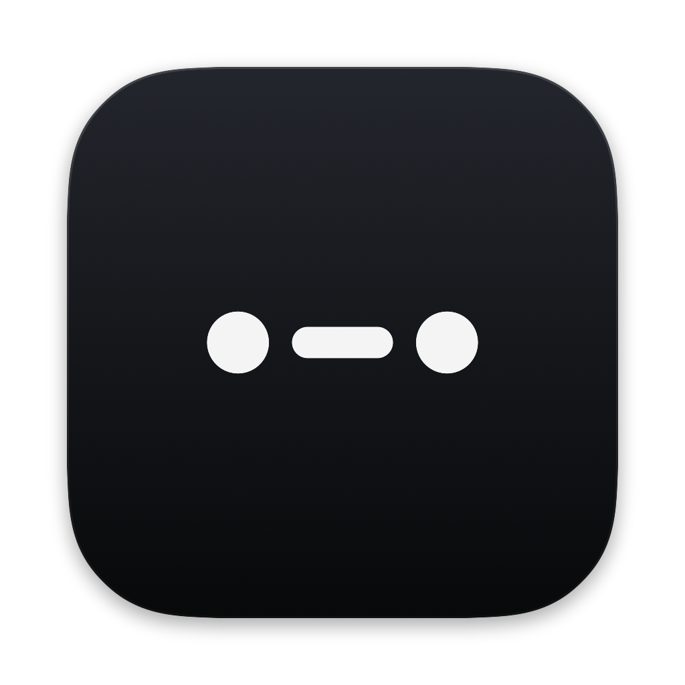
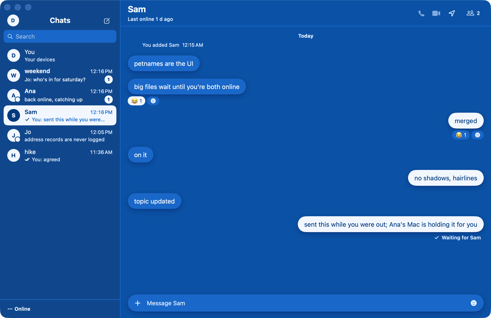

<p align="center">
  
</p>

<h1 align="center">baud</h1>

<p align="center">
  Messages with no server in the middle.<br>
  <a href="https://baud.rubric.sh">baud.rubric.sh</a> · <a href="docs/protocol.md">How it works</a> · Mac · iPhone · Android
</p>

<picture>
  <source media="(prefers-color-scheme: dark)" srcset="docs/images/mac-chat-dark.png">
  
</picture>

baud is a messenger for chats, groups and calls. Your messages go straight from your devices to
your friends' devices. When there's no direct path, a device of yours or of a friend carries them,
sealed, until the other side is back. There is no account, no phone number, and no company server
that sees who you talk to.

## How it works

- **You are a key.** Each device makes its own key pair, and your devices share a person key that
  signs your name and device list. Nothing is registered anywhere.
- **Friends meet by link.** A link or QR code works once, for an hour, and carries everything
  needed to connect after the `#`, so no server sees it.
- **Direct whenever possible.** Devices connect over QUIC ([iroh](https://github.com/n0-computer/iroh)),
  IPv6 first, and get through routers with port mapping and hole punching that a mutual friend's
  device coordinates. No public relay or discovery server is involved.
- **Friends carry the rest.** When two devices can't reach each other, a trusted device (yours, or
  a friend's) forwards the encrypted packets or holds a sealed envelope until the recipient is back.
- **Your address stays with people you chose.** Strangers can't connect to you and never learn
  your IP.

One small server exists: the [wake relay](wake), which asks Apple to wake a sleeping iPhone. It
never sees a message and keeps nothing. [docs/protocol.md](docs/protocol.md) covers the whole
design, what each party can see, and the current limits.

## What's in here

| Folder | What it is |
| --- | --- |
| [`peer/`](peer) | The network: identity, links, finding devices, hole punching, relays and carrying. Rust, on iroh. |
| [`core/`](core) | baud's Rust core: conversations, sealing, sync, files, calls. Used by the Android app. |
| [`BaudCore/`](BaudCore) | The same core in Swift, for the Mac and iPhone apps. |
| [`apps/`](apps) | The apps: `mac`, `ios` and `shared` (SwiftUI), `android` (Kotlin, Compose), `icon`. |
| [`wake/`](wake) | The wake relay for iPhones. A single Rust binary. |
| [`site/`](site) | [baud.rubric.sh](https://baud.rubric.sh), a static site. |
| [`docs/`](docs) | How the network works, and notes for working on baud. |

## Build it

You need rustup (stable), and for the apps Xcode 26 with [XcodeGen](https://github.com/yonaskolb/XcodeGen),
or Android Studio with the NDK and `cargo install cargo-ndk`.

```sh
# The network, the core and the wake relay
(cd peer && cargo test --workspace)
(cd core && cargo test --workspace)
(cd wake && cargo test)

# Mac and iPhone
peer/scripts/build-swift.sh            # builds the network for Swift (peer/swift/PeerKit)
xcodegen generate
xcodebuild -scheme BaudMac -destination 'platform=macOS' CODE_SIGNING_ALLOWED=NO build
xcodebuild -scheme Baud -destination 'platform=iOS Simulator,name=iPhone 17 Pro Max' CODE_SIGNING_ALLOWED=NO build
(cd BaudCore && swift test)

# Android (JAVA_HOME can be Android Studio's bundled JDK)
(cd apps/android && ./gradlew assembleDebug)   # builds the Rust core for the phone first
```

To see the app without a network, run the Mac build with `BAUD_DEMO=1`. It puts three demo people
on an in-process mesh around you, with chats, a group and a space.
[docs/development.md](docs/development.md) lists every switch and script.

## Status

baud is at version 0.2.19, for Mac, iPhone (a TestFlight beta) and Android, from
[baud.rubric.sh](https://baud.rubric.sh). It has not had an independent security review. Read
the [limits](docs/protocol.md#limits) before you rely on it.

## License

Public domain, under the [Unlicense](LICENSE). Do whatever you like with it. Vendored and
third-party pieces keep their own licenses, listed in [LICENSE](LICENSE).
