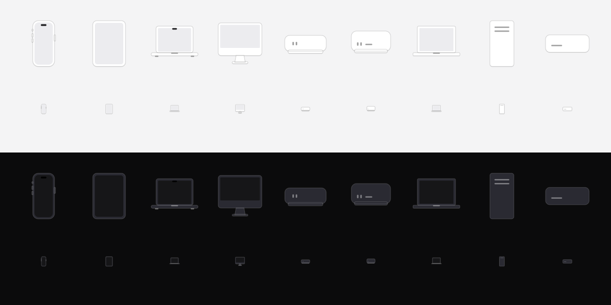

# Device icons

The family's devices as small flat tiles, the way Meter draws hardware and Apple draws its device
pickers: front-on, the face one step off the surface, a hairline outline and a 1 px soft shadow,
the hardware's real proportions, the screen a plain inset with nothing in it. Dense like Linear:
use them on a dot grid, in rows, on the lines of a network picture.

`python3 make.py <dir> [swift-out]` writes the SVGs and the parts as Swift for `apps/shared/Marks.swift`.

- **Two designed sizes.** The *hero* (64 in a picture, 96 on a page) keeps the details: the
  iPhone's island and buttons, the MacBook's notch, thumb dip and feet, the Mac mini's ports on its
  slightly inset base, the Studio's ports and card slot, the iMac's stand. The *mark* (20, in rows
  and on lines) is a reduction, not a scaled hero: the silhouette and its screen, or one detail.
- **Colours come from the palette:** the face one step off the surface, the outline the hairline,
  the screen a step deeper than the face, the island and notch near-black, details the text at
  ~38%. The SVGs here carry the light and dark looks literally (`<kind>.svg`, `<kind>-dark.svg`,
  `<kind>-mark.svg`, `<kind>-mark-dark.svg`); an app draws the same parts in its own tones.
- **No light, no dot, no glow.** Presence is not drawn in the device: it is the status word and a
  small light beside the device's name. Away is the same tile at 40%.
- Kinds: `iphone`, `ipad`, `macbook`, `imac`, `mac-mini`, `mac-studio`, `pc-laptop`, `pc-tower`,
  `drive`, each in the 24 × 24 box with the same presence: a phone is narrower, not smaller.

Written by `python3 make.py .` here (baud 0.2.0, 2026-10-09), which also emits the parts baud draws
in Swift (`apps/shared/Marks.swift`, `DeviceGlyph`). Darkroom follows.
